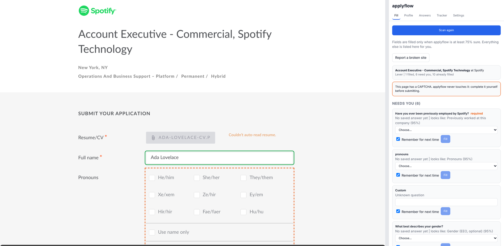
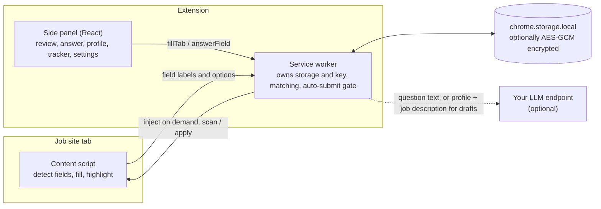

# applyflow

Fill job applications from your own profile, in your own browser, without guessing.

applyflow is a Chrome extension (Manifest V3) for job seekers. Open an application form on a site you already use, click **Scan and fill**, and applyflow reads the form, matches every question to your profile and saved answers, fills what it is confident about, and lists the rest in a side panel for you. Every answer you give is remembered for the next form.

- **Local-first.** Your profile, answers, resume and application history stay in your browser. Optional passphrase encryption (AES-GCM). No account, no server, no telemetry.
- **Asks instead of guessing.** A field is filled only when applyflow is at least 75% sure (you choose the threshold). Every filled field is outlined with its confidence; everything else goes to the side panel.
- **Works without AI, better with it.** Rules and fuzzy matching handle common questions. Bring your own model (Anthropic, OpenAI, Groq, Ollama, LM Studio) to understand unusual wordings and draft written answers.
- **Never invents.** Drafted answers may only use facts from your profile and the job description on the page. A truthfulness guard rejects drafts with unsupported numbers, employers, skills or credentials.
- **No stealth, no shortcuts.** It never handles passwords, never logs in for you, never touches CAPTCHAs, and uses no anti-detection techniques. Auto-submit is off by default.



*A live Lever posting during the dry-run smoke test: filled fields are outlined green, questions that need you are dashed orange. The panel shows a second scan: the 10 fields filled earlier are left alone, a CAPTCHA was detected, and 6 questions wait for the user.*

## Install (from the release zip)

1. Download `applyflow.zip` from the [latest release](https://github.com/HashirAKB/applyflow/releases/latest).
2. Unzip it into a folder you will keep (Chrome loads the extension from there).
3. Open `chrome://extensions` and switch on **Developer mode** (top right).
4. Click **Load unpacked**, choose the unzipped folder, then pin applyflow and click its icon to open the side panel.

Requires Chrome 116 or newer. To build from source instead: `npm ci && npm run build`, then load the `dist/` folder.

## How it works



1. You click **Scan and fill**. The service worker injects the content script into that tab only (nothing runs on pages until you ask).
2. The site adapter (Greenhouse, Lever, Ashby, Workable, LinkedIn, Naukri, or the generic one) finds the form. The detector reads every field's question from its label, ARIA attributes or surrounding text.
3. The matcher maps each question to a canonical question: remembered labels, then rules, then fuzzy matching, then (optionally) your LLM, each with a confidence score.
4. Confident fields are written using the browser's native value setters and the events React and Angular listen for, so the site's own state updates. Custom dropdowns are filled by typing and clicking the matching option.
5. Everything else is listed in the side panel. What you answer is filled and saved to your answer bank under that question, along with the exact wording, so the next site that asks it is filled automatically.
6. The application is logged in the tracker with the answers used and a snapshot of the job description.

## Supported sites

| Site | Adapter | Verification |
| --- | --- | --- |
| Greenhouse (job-boards / boards.greenhouse.io) | dedicated | Live-tested (dry run on a public posting, 2026-11-04) and fixture-tested on 2 captured postings |
| Lever (jobs.lever.co) | dedicated | Live-tested (dry run, 2026-11-04) and fixture-tested on a captured posting |
| Ashby (jobs.ashbyhq.com) | dedicated | Live-tested (dry run, 2026-11-04) and fixture-tested on 2 captured postings |
| Workable (apply.workable.com) | dedicated | Fixture-tested on a hand-built fixture. The live site rate-limited the build environment |
| LinkedIn Easy Apply | dedicated | **Unverified** until tested by a signed-in user. Built from documented DOM patterns, tested on a synthetic multi-step fixture |
| Naukri | dedicated | **Unverified** until tested by a signed-in user. Built from the documented chatbot apply flow, tested on a synthetic fixture |
| Any other site | generic heuristics | Fixture-tested. Needs one click to grant access to that site |

Live dry-run fill rates (fields filled automatically, the rest sent to the user): Greenhouse 10/18, Lever 11/15, Ashby 5/15. See [docs/live-report.md](docs/live-report.md) and [docs/fill-report.md](docs/fill-report.md). Rates depend on how much of the answer bank is filled in; the test profile answers only six common questions.

Found a site that breaks? Click **Report a broken site** in the side panel. It saves a redacted snapshot of the form and the field mapping (no personal values) that you can attach to an issue.

## Matching quality

On 196 labelled form questions ([eval/questions.tsv](eval/questions.tsv), results in [eval/results.md](eval/results.md), run in CI):

| Pipeline | Accuracy | Precision at threshold | Coverage | Ask rate |
| --- | --- | --- | --- | --- |
| Rules only | 90.8% | 99.4% | 90.4% | 17.3% |
| Rules + fuzzy | 85.2% | 99.4% | 91.0% | 16.8% |
| Rules + fuzzy + mock LLM | 89.8% | 98.2% | 93.3% | 13.8% |

Precision at threshold is the number that matters for trust: of the fields filled without asking, how many were mapped correctly. The fuzzy row's lower accuracy comes from low-confidence guesses on questions that have no canonical match; those are still sent to the user, so precision is unchanged. The mock LLM is a deterministic stand-in (a concept lexicon) used to test the pipeline offline, not a real model; run `EVAL_PROVIDER=anthropic ANTHROPIC_API_KEY=... npm run eval` to add a real-model row.

## Auto-submit and its safeguards

Auto-submit is **off by default**, and applyflow is designed to be useful without it: it fills, you review and click submit.

If you turn it on:

- **One-time risk confirmation.** Some sites prohibit automated activity in their terms (LinkedIn's User Agreement does). The risk to your account is yours, and the screen says so before anything is enabled.
- **Per-site opt-in.** Each site is enabled separately. Never on the generic adapter.
- **You start every run.** Auto-apply runs only when you click it on a posting you opened. applyflow never browses to postings by itself.
- **Strict gate.** It submits only if every required field is filled at or above your confidence threshold (or was already filled), and stops on any CAPTCHA, login prompt or unknown step, listing exactly why.
- **Daily cap** per site (default 10), counted before the click.
- **Pacing.** A pause of 0.8 to 2.5 seconds (configurable) between automated steps, so it never moves faster than a person.
- **Kill switch.** "Stop all auto-submit" is one click in the Fill tab and Settings, and is re-checked right before every click.
- **Dry run** (on by default when you enable auto-submit) does everything except click the final submit, and highlights the button instead.

No stealth: applyflow does not hide that it is automating, spoof anything, or try to avoid detection.

## Privacy

Everything is stored in `chrome.storage.local` on your machine. Nothing is sent anywhere except the LLM requests you configure, and only to the endpoint you choose. Details in [PRIVACY.md](PRIVACY.md). Security model and reporting in [SECURITY.md](SECURITY.md).

## Limitations

- Fill quality depends on your answer bank. The first few applications will ask more questions; it gets quieter as it learns.
- Custom dropdowns are filled by typing and choosing a matching option; widgets that do not follow ARIA combobox patterns are sent to you.
- File uploads: only your saved resume is attached, and only to resume/CV fields. Cover letter files and other documents are yours to attach.
- Answers are used as given: a salary saved in one currency is not converted for a form that asks in another.
- Resume import is heuristic. Always review the parsed profile; unusual layouts leave more fields empty.
- LinkedIn Easy Apply and Naukri adapters have not been confirmed on the live sites (they need a signed-in account). Check every field there.
- Pages that need a login, show a CAPTCHA, or present an unknown step always hand control back to you.
- Chrome only (Manifest V3, side panel API). Not tested on other Chromium browsers.

## Development

```bash
npm ci
npm run build        # dist/
npm run check        # lint + typecheck + unit tests
npm run eval         # matching eval, writes eval/results.md
npm run test:e2e     # Playwright: loads the built extension in Chromium against fixtures (+ live dry run if online)
npm run package      # applyflow.zip
```

Set `APPLYFLOW_SKIP_LIVE=1` to skip the live smoke test. CI runs lint, typecheck, unit tests, eval and e2e on every push and uploads the extension zip as an artifact.

- [CONTRIBUTING.md](CONTRIBUTING.md): how to add a site adapter
- [LEARNING.md](LEARNING.md): how the extension works, design notes, interview questions
- [SPEC.md](SPEC.md), [PLAN.md](PLAN.md), [DECISIONS.md](DECISIONS.md), [docs/adr](docs/adr)

## License

MIT. See [LICENSE](LICENSE).
